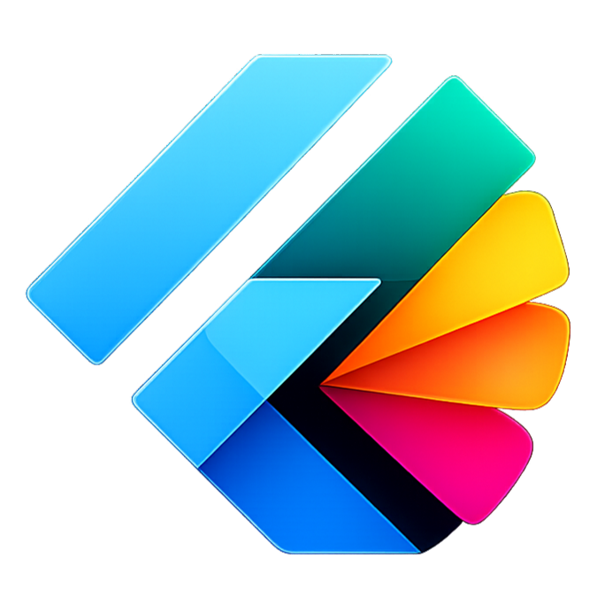
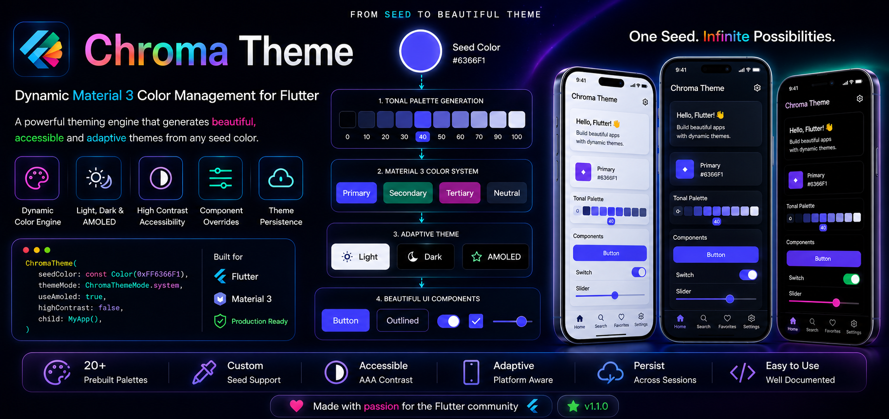
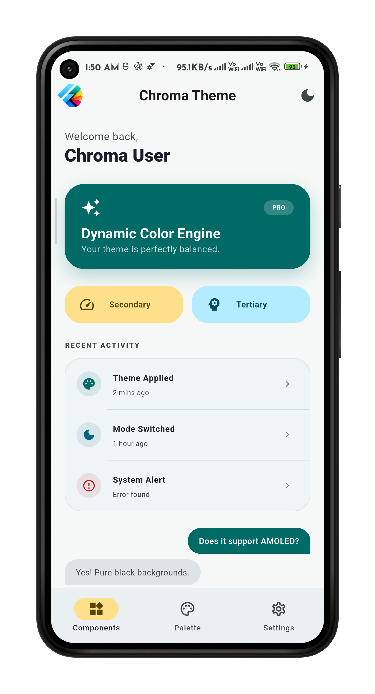
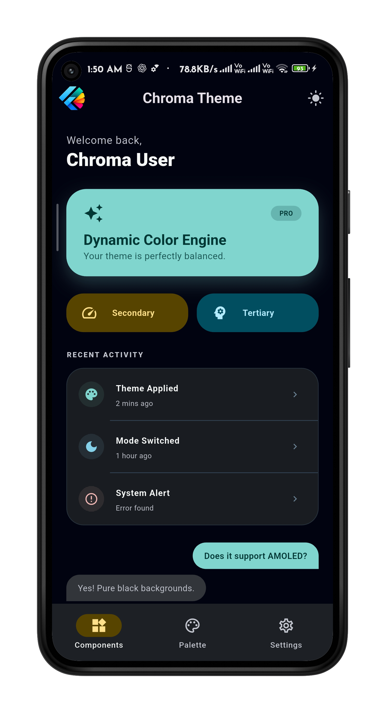
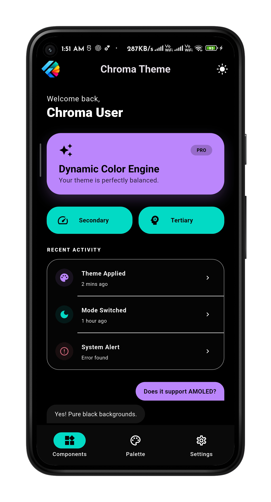
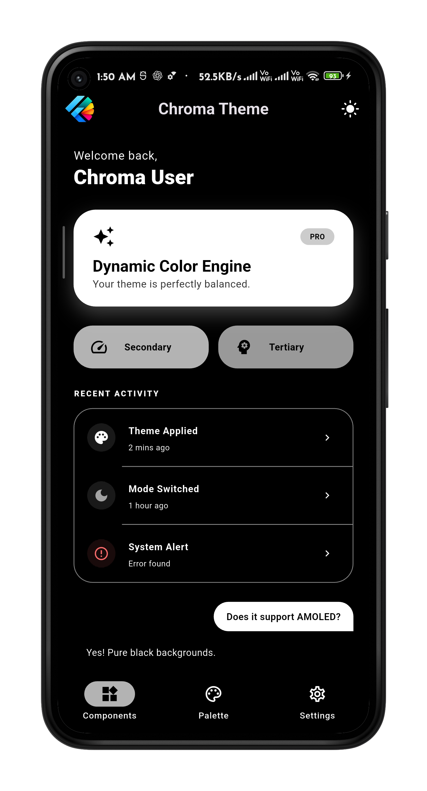

# Chroma Theme 🎨

**The definitive Material 3 dynamic theming engine for Flutter.**  
Ship adaptive color systems with 22 handcrafted palettes, pure AMOLED preservation, WCAG 2.1 contrast audits, image theme extraction, sun-aware scheduling, white-label branding, and zero-boilerplate drop-in widgets.

[](https://pub.dev/packages/chroma_theme)
[](https://opensource.org/licenses/MIT)
[](https://flutter.dev)
[](https://dart.dev)
[](https://buymeacoffee.com/satyam.sg)

<br><br>



---

## 🧭 Table of Contents
- [✨ Why Chroma Theme?](#-why-chroma-theme)
- [📦 Installation](#-installation)
- [🚀 Quick Start (60 Seconds)](#-quick-start-60-seconds)
- [🧩 Ready-to-Use Drop-in Widgets](#-ready-to-use-drop-in-widgets)
- [⚡ Superpowers & Flagship Capabilities](#-superpowers--flagship-capabilities)
  - [1. 5 Intelligent Theme Modes & True AMOLED](#1--5-intelligent-theme-modes--true-amoled)
  - [2. 22 Curated Predefined Palettes](#2--22-curated-predefined-palettes)
  - [3. Full 44-Token Material 3 Scheme](#3--full-44-token-material-3-scheme)
  - [4. Dynamic Seeds & Image Theme Extraction](#4--dynamic-seeds--image-theme-extraction)
  - [5. Sun-Aware Daylight Scheduler](#5--sun-aware-daylight-scheduler)
  - [6. Multi-Brand & White-Label Theming](#6--multi-brand--white-label-theming)
  - [7. WCAG 2.1 Accessibility Auto-Auditor](#7--wcag-21-accessibility-auto-auditor)
  - [8. Pure Dart Standalone Theme Exporter](#8--pure-dart-standalone-theme-exporter)
- [🛠️ BuildContext Extensions Reference](#️-buildcontext-extensions-reference)
- [🏛️ Global Component Overrides](#️-global-component-overrides)
- [💾 Storage Persistence](#-storage-persistence)
- [📱 Screenshots](#-screenshots)
- [☕ Support & Sponsorship](#-support--sponsorship)
- [📄 License & Author](#-license--author)

---

## ✨ Why Chroma Theme?

Building and maintaining a professional, accessible design system in Flutter usually requires writing hundreds of lines of boilerplate code to handle multiple `ThemeData` blocks, color palettes, dark mode edge cases, and accessibility contrast standards.

| Feature | Standard Flutter `ThemeData` | With Chroma Theme 2.0 🎨 |
| :--- | :--- | :--- |
| **Setup & Boilerplate** | Manual stateful routing & wiring | **1-line `ChromaTheme.builder`** |
| **AMOLED Mode** | Turns gray or washes out accents | **True `#000000` + original accents preserved** |
| **Pre-built Palettes** | 0 (Must define manually) | **22 Designer-curated M3 palettes** |
| **Color Roles Coverage** | Often partial or mismatched | **Full 44 M3 roles (Fixed, containers, surfaces)** |
| **Drop-in UI Widgets** | Build custom pickers from scratch | **Toggle, swatch picker & bottom sheet included** |
| **Accessibility Checks** | Manual contrast checking | **Built-in WCAG 2.1 AA/AAA contrast auditor** |
| **Daylight Scheduling** | Custom cron/timer logic | **Automatic `ChromaSchedule` wall-clock engine** |
| **Code Export** | Manual copy-pasting | **1-click pure Dart code generator** |

---

## 📦 Installation

Add `chroma_theme` to your `pubspec.yaml`:

```yaml
dependencies:
  chroma_theme: ^2.0.0
```

Then run:
```bash
flutter pub get
```

---

## 🚀 Quick Start (60 Seconds)

Wrap your `MaterialApp` with `ChromaTheme.builder`:

```dart
import 'package:flutter/material.dart';
import 'package:chroma_theme/chroma_theme.dart';

void main() {
  runApp(const MyApp());
}

class MyApp extends StatelessWidget {
  const MyApp({super.key});

  @override
  Widget build(BuildContext context) {
    return ChromaTheme.builder(
      initialMode: ChromaThemeMode.system,
      initialPalette: ChromaPalette.emerald,
      builder: (context, theme, darkTheme, themeMode) {
        return MaterialApp(
          title: 'Chroma Theme App',
          theme: theme,
          darkTheme: darkTheme,
          themeMode: themeMode,
          home: const HomeScreen(),
        );
      },
    );
  }
}
```

> [!TIP]
> `ChromaTheme.builder` ensures that `theme`, `darkTheme`, and `themeMode` are injected directly into `MaterialApp`, eliminating nested Navigator and MediaQuery routing bugs.

---

## 🧩 Ready-to-Use Drop-in Widgets

Ship complete theme selection interfaces in seconds with zero custom widget code:

### 1. One-Line Theme Bottom Sheet
Open a comprehensive bottom sheet containing mode toggles and palette swatches:
```dart
IconButton(
  icon: const Icon(Icons.palette_outlined),
  onPressed: () => showChromaThemeSheet(context),
)
```

### 2. Segmented Mode Toggle
A clean, animated toggle control between Light, Dark, and AMOLED:
```dart
const ChromaThemeToggle()
```

### 3. Palette Swatch Selector
A horizontal scrollable color circle picker showcasing all 22 palettes:
```dart
const ChromaPaletteSelector(swatchSize: 42.0)
```

---

## ⚡ Superpowers & Flagship Capabilities

### 1. 🌓 5 Intelligent Theme Modes & True AMOLED
Chroma Theme provides 5 distinct, first-class theme modes:
- `ChromaThemeMode.system`: Automatically tracks operating system daylight/nighttime settings.
- `ChromaThemeMode.light`: Crisp, daytime Material 3 light mode.
- `ChromaThemeMode.dark`: Standard Material 3 dark mode.
- `ChromaThemeMode.highContrast`: Accessibility-first scheme with boosted contrast ratios and distinct outlines.
- `ChromaThemeMode.amoled`: Forces pure black (`#000000`) surfaces for OLED battery savings, **while strictly preserving your brand's primary and secondary accent colors**.

```dart
// Switch theme mode from anywhere:
context.chroma.setTheme(ChromaThemeMode.amoled);

// Or use the one-line toggle shortcut:
context.toggleTheme(supportAmoled: true);
```

---

### 2. 🎨 22 Curated Predefined Palettes
Choose from 22 handcrafted palettes designed across 6 distinct aesthetic families:

| Aesthetic | Palettes |
| :--- | :--- |
| **Modern & Basic** | `blue`, `mono`, `emerald` |
| **Nature & Earthy** | `mintLatte`, `neonForest`, `emeraldRoad`, `colonialNature` |
| **Cool & Oceanic** | `oceanSignal`, `midnightMint`, `softOcean`, `colonialWaterloo` |
| **Rich & Jewel** | `berryBlush`, `raisinCaramel`, `royalBerry`, `noirMauve`, `softMauve` |
| **Industrial & Dark**| `blackMetal`, `onyxSpring`, `midnightChrysocolla`, `khakiSlate`, `armyCoral` |
| **Soft & Minimal** | `iceLatte`, `uniformPalesun` |

```dart
// Select a palette:
context.chroma.setPalette(ChromaPalette.oceanSignal);

// Or cycle through them dynamically:
context.chroma.nextPalette();
context.chroma.randomPalette();
```

---

### 3. 🎯 Full 44-Token Material 3 Scheme
Unlike basic generators that only populate primary and secondary colors, Chroma Theme accurately maps all **44 official Material 3 color roles**:
- **Fixed Roles**: `primaryFixed`, `primaryFixedDim`, `onPrimaryFixed`, `secondaryFixed`, `tertiaryFixed`, etc.
- **Surface Elevation Levels**: `surface`, `surfaceDim`, `surfaceBright`, `surfaceContainerLowest`, `surfaceContainerLow`, `surfaceContainer`, `surfaceContainerHigh`, and `surfaceContainerHighest`.
- **Outlines & Inverses**: `outline`, `outlineVariant`, `inverseSurface`, `onInverseSurface`, and `inversePrimary`.

---

### 4. 🌈 Dynamic Seeds & Image Theme Extraction

#### A. Single Color Seed
Generate an entire theme from a single accent color:
```dart
context.chroma.setDynamicSeed(const Color(0xFF6750A4));
```

#### B. Granular Multi-Seed Control
Specify individual seeds for primary, secondary, and neutral surfaces:
```dart
context.chroma.setSeeds(
  const ChromaSeeds(
    primary: Color(0xFF00A19B),
    secondary: Color(0xFFE4DDD3),
    neutralLight: Color(0xFFF5F1EA),
    neutralDark: Color(0xFF0C1413),
  ),
);
```

#### C. Dynamic Extraction From Images
Extract colors dynamically from network images, asset images, or photos:
```dart
await context.chroma.setThemeFromImage(
  const NetworkImage('https://example.com/album_art.jpg'),
);
```

---

### 5. ⏰ Sun-Aware Daylight Scheduler
Automatically adapt between light mode during the day and dark or AMOLED mode at night:

```dart
ChromaTheme.builder(
  schedule: const ChromaSchedule(
    lightTime: TimeOfDay(hour: 6, minute: 30),  // Sunrise
    darkTime: TimeOfDay(hour: 19, minute: 0),   // Sunset
    darkEffectiveMode: ChromaThemeMode.amoled,   // Pure black at night
  ),
  builder: (context, theme, darkTheme, themeMode) => MaterialApp(/* ... */),
)
```

---

### 6. 🏢 Multi-Brand & White-Label Theming
Define and hot-swap between multiple brand identities at runtime:

```dart
final controller = ChromaThemeController(
  brands: const [
    ChromaBrandProfile(
      id: 'brand_fintech',
      name: 'Fintech Pro',
      palette: ChromaPalette.blue,
      fontFamily: 'Inter',
    ),
    ChromaBrandProfile(
      id: 'brand_eco',
      name: 'Eco Green',
      palette: ChromaPalette.emerald,
      fontFamily: 'Poppins',
    ),
  ],
);

// Switch brand with 1 line of code:
controller.setBrand('brand_eco');
```

---

### 7. ♿ WCAG 2.1 Accessibility Auto-Auditor
Validate your active theme against W3C contrast standards for text readability:

```dart
final audit = ChromaAuditor.audit(context.chromaColors);

print('Overall Accessible: ${audit.isAccessible}');
print('Normal text (AA) pass rate: ${(audit.aaNormalPassRate * 100).toInt()}%');

for (final pair in audit.pairs) {
  print('${pair.foregroundRole} on ${pair.backgroundRole}: ${pair.ratio.toStringAsFixed(2)}:1 (AA: ${pair.passesAANormal})');
}
```

---

### 8. 📤 Pure Dart Standalone Theme Exporter
Export your dynamic theme directly to clean, dependency-free Flutter source code ready to paste into any project:

```dart
final dartSource = ChromaThemeExporter.exportToDart(
  scheme: context.chromaColors,
  themeName: 'MyProductionTheme',
  isDark: context.isDarkMode,
);
```

---

## 🛠️ BuildContext Extensions Reference

Chroma Theme equips `BuildContext` with ergonomic shortcuts:

| Extension | Return Type | Description |
| :--- | :--- | :--- |
| `context.chroma` | `ChromaThemeController` | Main controller for changing modes, palettes, and seeds. |
| `context.chromaColors` | `ColorScheme` | Active Material 3 ColorScheme. |
| `context.chromaPrimary` | `Color` | Shortcut to `context.chromaColors.primary`. |
| `context.chromaSecondary` | `Color` | Shortcut to `context.chromaColors.secondary`. |
| `context.chromaSurface` | `Color` | Shortcut to `context.chromaColors.surface`. |
| `context.chromaText` | `TextTheme` | Active TextTheme. |
| `context.chromaTones` | `ChromaTones` | Cached Material 3 tonal palettes (0-100) per seed. |
| `context.isDarkMode` | `bool` | True if the current effective theme is dark. |
| `context.toggleTheme()` | `void` | Toggles between light and dark/amoled mode. |

---

## 🏛️ Global Component Overrides

Style specific Material widgets globally without messy ThemeData blocks:

```dart
ChromaTheme.builder(
  overrides: ChromaOverrides(
    appBarTheme: const AppBarTheme(centerTitle: true, elevation: 0),
    cardTheme: CardThemeData(
      elevation: 0,
      shape: RoundedRectangleBorder(borderRadius: BorderRadius.circular(16)),
    ),
    elevatedButtonTheme: ElevatedButtonThemeData(
      style: ElevatedButton.styleFrom(shape: const StadiumBorder()),
    ),
  ),
  builder: (context, theme, darkTheme, themeMode) => MaterialApp(/* ... */),
)
```

---

## 💾 Storage Persistence

Implement `ThemePersistence` to save user selections into SharedPreferences, Hive, or SQLite:

```dart
class AppThemeStorage implements ThemePersistence {
  final SharedPreferences prefs;
  AppThemeStorage(this.prefs);

  @override
  Future<void> saveThemeMode(ChromaThemeMode mode) async =>
      prefs.setString('theme_mode', mode.name);

  @override
  Future<ChromaThemeMode?> loadThemeMode() async {
    final val = prefs.getString('theme_mode');
    return val != null ? ChromaThemeMode.values.byName(val) : null;
  }

  @override
  Future<void> savePalette(ChromaPalette palette) async =>
      prefs.setString('palette', palette.name);

  @override
  Future<ChromaPalette?> loadPalette() async {
    final val = prefs.getString('palette');
    return val != null ? ChromaPalette.values.byName(val) : null;
  }

  @override
  Future<void> saveSeeds(ChromaSeeds? seeds) async { /* ... */ }

  @override
  Future<ChromaSeeds?> loadSeeds() async { /* ... */ }
}
```

Pass it to `ChromaTheme.builder`:
```dart
ChromaTheme.builder(
  persistence: AppThemeStorage(prefs),
  builder: (context, theme, darkTheme, themeMode) => MaterialApp(/* ... */),
)
```

---

## 📱 Screenshots

| Light Mode | Dark Mode | AMOLED Mode | High Contrast |
| :---: | :---: | :---: | :---: |
|  |  |  |  |

---

## ☕ Support & Sponsorship

If you find **Chroma Theme** helpful, saved hours of development time, or use it in your production apps, please consider buying me a coffee to support its ongoing development:

<br>

<a href="https://buymeacoffee.com/satyam.sg" target="_blank">
  
</a>

<br><br>

Your support helps maintain the library, add new palettes, and build powerful developer tools! ☕✨

---

## 📄 License & Author

This project is licensed under the MIT License - see the [LICENSE](LICENSE) file for details.

### 👨‍💻 Satyam Gawali

[](https://github.com/Satyam-Gawali)
[](https://www.linkedin.com/in/satyam-gawali-b4623b268/)
